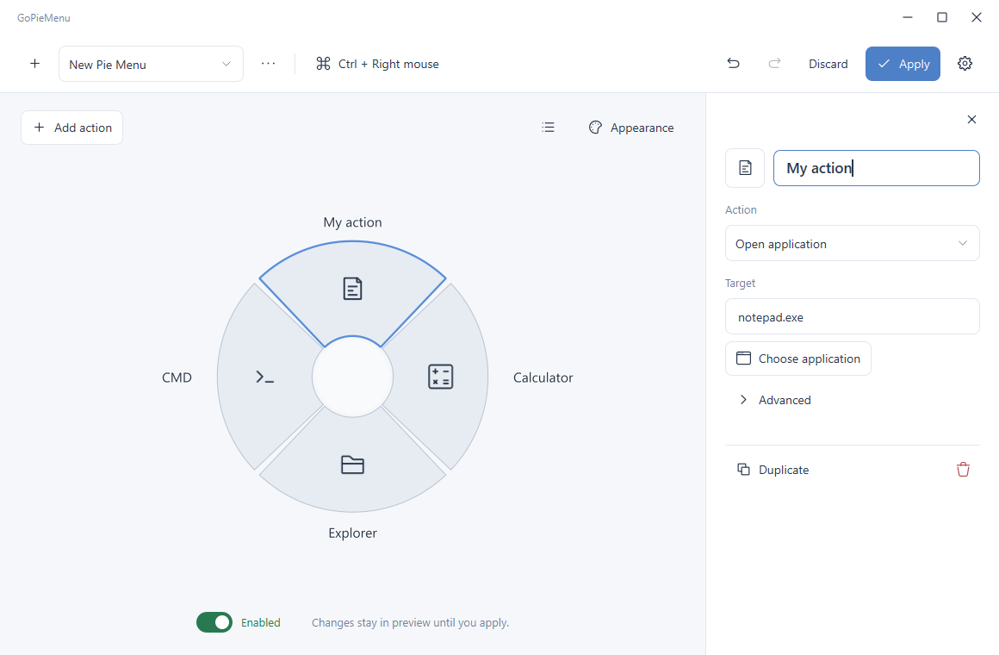

# GoPieMenu

[English](README.md) · [繁體中文](README.zh-TW.md) · [简体中文](README.zh-CN.md)

A customizable radial menu for Windows and macOS: shortcuts, applications, files, websites, and commands.

[Download for Windows x64](https://github.com/RyuuMeow/GoPieMenu/releases/tag/v2.3.0) · [All releases](https://github.com/RyuuMeow/GoPieMenu/releases) · [What's new and upgrading](CHANGELOG.md#230)



The interface supports English, Traditional Chinese, and Simplified Chinese. New configurations follow the system UI language; unsupported languages use English. Settings → Language offers **Later** or a blue **Restart** button. Restart applies all pending changes; Later keeps the draft for further editing. Chinese interfaces use Microsoft JhengHei UI on Windows and PingFang on macOS. Existing configurations with an explicit language keep that choice. Your saved menu and action names are not retranslated.

Opening GoPieMenu manually shows the editor, including when it is already running in the tray. Windows startup keeps it in the tray.

## macOS

GoPieMenu builds as a universal app for macOS 12 or newer on Apple silicon and Intel Macs. CI builds, tests, and packages a `GoPieMenu-<version>.dmg`; the disk image is attached to the next release together with the Windows installer.

The macOS app lives in the menu bar without a Dock icon; quit it from the menu bar item. Global triggers and keyboard actions need **Accessibility** and **Input Monitoring** permission: enable GoPieMenu under System Settings → Privacy & Security, then restart the app. The build is ad-hoc signed, so the first manual launch needs **Open** from the Finder context menu or **Open Anyway** under Privacy & Security. Startup at login uses a LaunchAgent. Updates download and verify the disk image, then mount it so you can replace GoPieMenu in Applications.

## Edit your menu

1. Open **Settings** from the tray icon. Use **+** beside the menu selector to create and select a menu. The adjacent three-dot menu contains New, Duplicate, and Delete; deleting selects the first remaining menu.
2. Click a slice to edit it. **Add action** creates an action or a submenu. Empty targets and shortcuts can be saved as placeholders; triggering them does nothing. Right-click an action in the preview or organizer to **Duplicate** or **Delete action**.
3. Open **Arrange actions** with the layers button and drag anywhere on a row to reorder it without changing the current selection. The three-line handle and insertion line mark the interaction; the list scrolls near its edges. Double-click a submenu or choose **Edit actions** to edit it in the same workspace. Submenus contain actions only.
4. Edit the trigger and application scope from the trigger summary. Mouse hold supports independent **Ctrl / Shift / Alt / Win** modifiers and five mouse buttons (on macOS the Win modifier is Command). The **Enabled / Disabled** switch controls the menu; new and copied menus start disabled.
5. Changes appear immediately in the preview, whose position stays fixed when names change. **Apply** validates and saves them before the running menu changes. **Apply** and **Discard** stay visible and activate when there are changes. Ctrl+Z and Ctrl+Y (Cmd+Z and Cmd+Y on macOS) undo and redo.

Switching menus preserves all drafts. Closing the editor hides it to the tray and preserves edits; quitting asks how to handle unapplied changes. Import creates an undoable draft. Invalid imports and failed saves leave the current configuration intact.

The default trigger is **Ctrl + right mouse button**: hold, point, and release. Keyboard hold and keyboard toggle are also supported. Toggle mode confirms on a left click; Escape cancels. Application-specific menus take precedence over global menus.

## Persistent floating menus

Choose **Persistent floating menu** under a menu's **Display mode**. It appears automatically when a matching application is in the foreground; an empty application scope makes it global. The menu stays on top without taking keyboard focus. Click actions repeatedly, drag the center to move, and click a submenu sector to toggle it. Moving away keeps the submenu open. **Collapse submenu after click** is off by default; enable it to close the list after selecting a child action while keeping the pie visible. Only one submenu is expanded at a time.

All display modes share one main menu. An application-specific persistent menu blocks global shortcuts. A global persistent menu yields to an application-specific shortcut menu and returns when that interaction ends. For equally specific persistent menus, the first enabled, nonempty profile in configuration order wins and reserves that scope.

Right-click the center and choose **Hide all persistent menus**, or use the matching tray toggle. Switching applications does not undo this choice; clear the tray toggle to restore menus. Hidden persistent menus still reserve their scope, so a hidden application-specific menu continues to block global shortcuts. Disable that profile or change its application scope to release the reservation. Positions, expanded submenus, and the hidden toggle are remembered separately from configuration drafts. Tray Pause and shortcut recording also suspend persistent menus.

Enable **Show a hint when an action runs** in Settings to display the action icon and name on the pie menu’s monitor. Choose one of six positions, background opacity, edge margin, size, and hold time. **Preview hint** shows the draft on the editor’s monitor. Apply saves it for all profiles.

## Appearance and icons

The editor uses a light Frost theme with a custom white title bar, rounded dialogs, and a matching tray menu. The default Frost menu is nearly opaque; choose **Frost** again to apply the new preset to an existing configuration. Appearance keeps the preview visible and offers presets and size, with detailed geometry, colors, and animation under Advanced. The preview hint stays visible when a menu is disabled.

**Appearance always applies to the selected profile.** Presets, sizes, colors, opacity, and animation can be changed independently. Existing menus retain their saved appearance, and duplicated menus copy it without linking subsequent edits.

Switch between **Pie menu** and **Submenu** to set text size, icon size, text outline, and border width separately. Submenu rows grow automatically to fit their text and icons. Colors, font family, opacity, and animation remain shared within the profile. Selecting Submenu opens an existing submenu in the preview; legacy settings retain their previous appearance.

The [color picker](resources/demo/ColorPicker.png) combines a hue ring, saturation/value square, H/S/V/opacity sliders and numeric fields, RGB/RGBA hex input, and 12 recent colors. **Use color** updates the draft; **Cancel** leaves it unchanged.

The icon picker has search, a virtualized grid, and Clear. Built-in icons are embedded; custom SVG, PNG, JPEG, and ICO files can be placed in the icon folder opened from Settings. Preview and runtime share rendering and icon resolution.

Configuration remains version 1.0 JSON, stored under Qt's application-data directory. Export and import are available in Settings.

The application and [tray menu](resources/demo/TrayMenu.png) use the new Pie Menu artwork and light styling. The GitHub button beside **About** opens this project's repository.

## Updates

GoPieMenu checks for newer stable GitHub releases at startup. A visible editor shows an update dialog; when hidden or minimized, a tray notification opens the same dialog. **Skip this version** remembers that release; **Settings → Check for updates** can revisit it.

Release notes use the current interface language, with English fallback and shared validation information. **Update** downloads the platform release file and verifies it against `SHA256SUMS.txt`: the Windows installer on Windows, the disk image on macOS. **Install and exit** asks you to resolve unapplied edits, then opens the Windows installer permission prompt; cancelling that prompt keeps GoPieMenu running. On macOS, **Open and exit** resolves unapplied edits and mounts the verified disk image so you can replace the app in Applications. Closing the update dialog with **Later** does not install anything.

The [changelog](CHANGELOG.md) is the source for all release notes. Publishing a version extracts only its section into the GitHub Release body, which the application reads. Preview and smoke-test modes do not check for updates.

## Build and verify

Windows requires Visual Studio 2022 with C++ tools, CMake 3.21+, and Qt 6.9 with Widgets, Quick, QML, Quick Controls, SVG, Network, Linguist Tools, and Test. macOS requires Xcode 15 or newer with the command line tools, CMake 3.21+, and the same Qt 6.9 components.

Windows:

```powershell
./scripts/build.ps1 -QtRoot "C:/Qt/6.9.0/msvc2022_64"
```

macOS:

```bash
export QT_ROOT_DIR="$HOME/Qt/6.9.0/macos"
./scripts/build-macos.sh
# Universal build for Apple silicon and Intel Macs:
GPM_OSX_ARCHITECTURES="arm64;x86_64" ./scripts/build-macos.sh
```

Both entry points build Release and run core and UI regression tests; Windows runs the QML suite at 100%, 125%, 150%, and 200% scale, macOS at 100% and 200% (the Retina factor). Windows runs them on the desktop; macOS uses an offscreen 1920 × 1080 screen and the software Qt Quick backend. Test screenshots are written to `build/artifacts`. Use `-SkipTests` on Windows or `SKIP_TESTS=1` on macOS for an incremental build.

Run `build/Release/GoPieMenu.exe --settings` on Windows with Qt's bin directory on PATH; on macOS open `build/GoPieMenu.app` or run `build/GoPieMenu.app/Contents/MacOS/GoPieMenu --settings`. `--preview` opens an isolated temporary configuration without global hooks, action execution, or startup changes.

To package on Windows with Inno Setup 6 installed:

```powershell
./scripts/package.ps1 -QtRoot "C:/Qt/6.9.0/msvc2022_64"
```

On macOS, `./scripts/package-macos.sh` deploys Qt/QML, signs the bundle ad hoc, checks startup without the SDK, and writes `Output/GoPieMenu-<version>.dmg` and `Output/SHA256SUMS.macos.txt`. CI uses the same build and packaging entry points on pull requests and main-branch pushes. On a version tag it publishes the installer, the disk image, a merged `SHA256SUMS.txt`, and matching release notes.

For packaging without launching the startup check, pass `-SkipSmokeTest` on Windows or `SKIP_SMOKE_TEST=1` on macOS. CI retains the default check.

See [architecture and validation](docs/architecture.md) for module boundaries, test coverage, measurements, and remaining hardware checks, and [macOS manual checks](docs/macos-manual-checks.md) for the permission, focus, and packaging acceptance list.

## Credits and license

[Iconoir](https://github.com/iconoir-icons/iconoir) supplies the built-in icons under its MIT license. GoPieMenu is [GPL-3.0](LICENSE).
