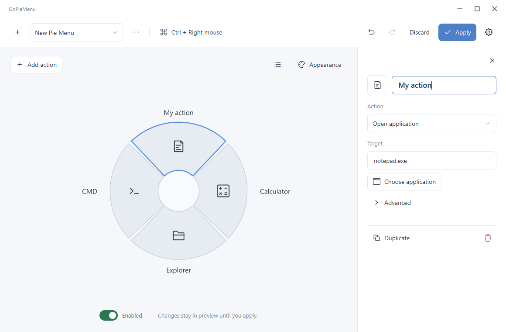

# GoPieMenu

[English](README.md) · [繁體中文](README.zh-TW.md) · [简体中文](README.zh-CN.md)

Windows 圆形快捷菜单，支持快捷键、应用程序、文件、网址和命令。

[下载 v2.0.0（Windows x64）](https://github.com/RyuuMeow/GoPieMenu/releases/tag/v2.0.0) · [更新与升级说明](CHANGELOG.md#200)



界面支持英文、繁体中文及简体中文。新配置默认跟随系统界面语言，不支持的语言使用英文。切换“设置 → 语言”会显示“稍后”及蓝色“重新启动”按钮；重新启动会先应用所有待保存更改，稍后则保留草稿继续编辑。中文界面使用 Microsoft JhengHei UI。已有配置若已指定语言，会保留该选择；已保存的菜单及操作名称不会重新翻译。

手动打开 GoPieMenu 会显示编辑器，已在系统托盘运行时也会唤回窗口；随 Windows 自动启动时则留在系统托盘。

## 使用方式

1. 从系统托盘打开 **Settings**。顶部菜单左侧的 **+** 可新建并切换到新菜单；三点管理菜单可新建、复制和删除，删除后切换到第一个菜单。
2. 点击扇形直接编辑；**Add action** 添加操作或子菜单。目标与快捷键可以留空，触发空白操作时不执行任何动作。在预览或排序列表中右键点击操作，可 **Duplicate** 或 **Delete action**。
3. 点击图层按钮展开 **Arrange actions**，拖动整行排序并保留原来的选择；三横线为拖动手柄，插入线标明目标位置，靠近边缘时自动滚动。双击子菜单或点击 **Edit actions**，在原工作区编辑；子菜单只包含操作，保留两层结构。
4. 点击顶部触发方式，修改快捷键与应用范围。鼠标按住模式可独立组合 **Ctrl／Shift／Alt／Win** 与五种鼠标按键；**Enabled／Disabled** 开关控制启用状态。新建及复制的菜单默认禁用。
5. 草稿即时预览，改名不会移动预览位置。点击 **Apply** 验证并保存成功后才影响实际菜单；**Apply** 和 **Discard** 固定显示，有更改时才可操作。Ctrl+Z／Ctrl+Y 撤销／重做。

切换配置保留草稿。关闭窗口隐藏到托盘，退出时处理未应用的更改。导入先成为可撤销的草稿；损坏文件和保存失败不会覆盖当前配置。

默认触发为 **Ctrl＋鼠标右键**：按住、指向、释放执行。也支持键盘按住及切换模式；切换模式以左键确认，Escape 取消。当前应用专属配置优先于全局配置。

## 外观与图标

编辑器采用浅色 Frost 风格、自定义白色标题栏、圆角对话框与一致的托盘菜单。默认 Frost 配色更接近不透明；已有配置可重新选择 **Frost** 应用新预设。**Appearance** 提供预设与大小，详细几何、颜色和动画位于 Advanced，预览始终可见。禁用菜单不会隐藏预览提示文字。

**Appearance 始终只应用到当前的 profile**，预设、尺寸、配色、透明度和动画均可独立设置。已有菜单保留原来的外观；复制菜单会带入外观，之后的修改互不影响。

[选色器](resources/demo/ColorPicker.png)提供色相圆环、饱和度／明度方形、H／S／V／透明度滑条与数值框、RGB／RGBA Hex，以及最近使用的 12 色。点击 **Use color** 才写入草稿，**Cancel** 保留原色。

内置 Iconoir 图标嵌入程序，选择器提供搜索、网格与清除。可在 Settings 打开的图标文件夹中放入自定义 SVG、PNG、JPEG、ICO。

JSON 配置格式保持 1.0，位于 Qt 应用数据目录；Settings 提供导入／导出。

程序与[托盘菜单](resources/demo/TrayMenu.png)已采用新版 Pie Menu 标志与浅色风格，**About** 旁的 GitHub 按钮可打开项目页面。

## 更新

GoPieMenu 会在启动时检查 GitHub 是否有更新的稳定版本。编辑器打开时显示更新对话框；隐藏或最小化时显示托盘通知，点击后可查看更新内容。“跳过此版本”会记住该版本，也可从“设置 → 检查更新”重新查看。

更新说明按当前界面语言显示，缺少翻译时使用英文，验证信息则共用。“更新”会下载 Windows 安装程序并验证 `SHA256SUMS.txt`；点击“安装并退出”后，会先处理尚未应用的编辑，再打开 Windows 安装权限提示。取消权限提示时 GoPieMenu 会继续运行；点击“稍后”关闭更新窗口不会自动安装。

所有更新说明集中在 [CHANGELOG.md](CHANGELOG.md)。发布时只提取该版本区块至 GitHub Release，程序再从 Release 读取内容。预览和启动验证模式不会检查更新。

## 构建与测试

需要 Windows、Visual Studio 2022 C++、CMake 3.21+、Qt 6.9（Widgets、Quick、QML、Quick Controls、SVG、Network、Linguist Tools、Test）。

```powershell
./scripts/build.ps1 -QtRoot "C:/Qt/6.9.0/msvc2022_64"
```

命令构建 Release，运行核心测试及 100%、125%、150%、200% 缩放 UI 测试，截图输出至 `build/artifacts`。增量构建可加 `-SkipTests`。

将 Qt bin 加入 PATH 后运行 `build/Release/GoPieMenu.exe --settings`。参数 `--preview` 使用临时配置，不安装全局钩子、不执行操作、不修改 Windows 启动设置。

安装 Inno Setup 6 后，运行 `./scripts/package.ps1 -QtRoot "C:/Qt/6.9.0/msvc2022_64"`，即可部署 Qt/QML、检查独立启动，并在 `Output` 生成安装包与 `SHA256SUMS.txt`。CI 使用相同构建与打包入口；版本标签通过验证后，会发布安装包、校验文件和对应更新说明。

架构、测试范围、性能数据与硬件验证说明见 [架构与验证](docs/architecture.md)。

## 许可

GoPieMenu 使用 [GPL-3.0](LICENSE)。内置图标来自 [Iconoir](https://github.com/iconoir-icons/iconoir)，采用 MIT 许可。
