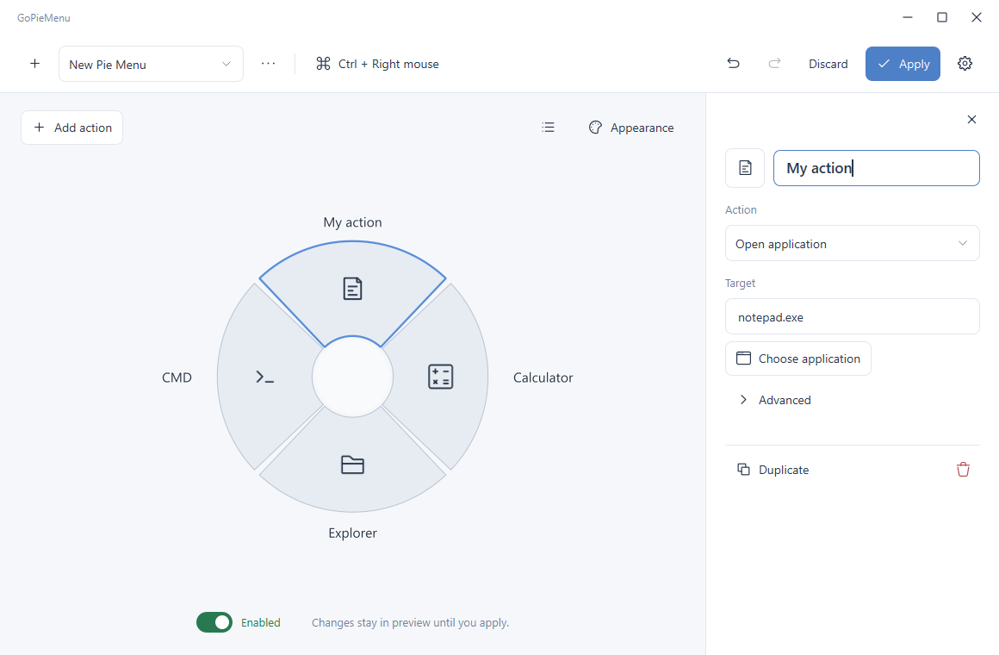

# GoPieMenu

[English](README.md) · [繁體中文](README.zh-TW.md) · [简体中文](README.zh-CN.md)

Windows 與 macOS 圓形快捷選單，可錄製快捷鍵、啟動應用程式、開啟檔案／網址與執行指令。

[下載 Windows x64 版](https://github.com/RyuuMeow/GoPieMenu/releases/tag/v2.3.0) · [所有版本](https://github.com/RyuuMeow/GoPieMenu/releases) · [更新與升級說明](CHANGELOG.md#230)



介面支援英文、繁體中文及簡體中文。新設定預設跟隨系統介面語言，不支援的語言使用英文。切換「設定 → 語言」會顯示「稍後」及藍色「重新啟動」按鈕；重新啟動會先套用所有待存變更，稍後則保留草稿繼續編輯。中文介面在 Windows 使用微軟正黑體 UI，在 macOS 使用 PingFang。既有設定若已指定語言，會保留該選擇；已儲存的選單及動作名稱不會重新翻譯。

手動開啟 GoPieMenu 會顯示編輯器，已在系統匣執行時也會喚回視窗；隨 Windows 自動啟動時則留在系統匣。

## macOS

GoPieMenu 以 macOS 12 以上的通用版本提供，同時支援 Apple 晶片與 Intel Mac。CI 會建置、測試並打包 `GoPieMenu-<version>.dmg`，與 Windows 安裝程式一同附在下一個發行版本。

macOS 版本是選單列項目，不顯示 Dock 圖示，請從選單列結束程式。全域觸發與鍵盤動作需要**輔助使用**與**輸入監控**權限：請到「系統設定 → 隱私權與安全性」允許 GoPieMenu，再重新啟動程式。本版本使用 ad-hoc 簽章，首次手動開啟需在 Finder 以右鍵選擇「打開」，或到「隱私權與安全性」選擇「仍要打開」。登入時啟動使用 LaunchAgent。更新會下載並驗證磁碟映像，掛載後讓你以新版本取代「應用程式」中的舊版。

## 使用方式

1. 從系統匣開啟 **Settings**。頂部選單左側的 **+** 可新增並切換到新選單；三點管理選單可新增、複製或刪除，刪除後切換到第一個選單。
2. 點擊扇形直接編輯；**Add action** 新增動作或子選單。目標與快捷鍵可以留空，觸發空白動作時不執行任何操作。在預覽或排序清單對動作按右鍵，可 **Duplicate** 或 **Delete action**。
3. 按圖層按鈕展開 **Arrange actions**，可拖曳整列排序，保留原本選取狀態；三橫線為拖曳把手，插入線標示目的位置，靠近邊緣時自動捲動。雙擊子選單或按 **Edit actions**，即可在原工作區編輯；維持兩層結構。
4. 點擊頂部觸發方式，修改快捷鍵與應用程式範圍。滑鼠按住模式可獨立組合 **Ctrl／Shift／Alt／Win** 與五種滑鼠按鍵（macOS 上 Win 即 Command）；**Enabled／Disabled** 開關控制啟用狀態。新增及複製的選單預設停用。
5. 草稿即時顯示在畫布，改名不會移動預覽位置。按 **Apply** 驗證並保存成功後才影響實際選單；**Apply** 和 **Discard** 固定顯示，有變更時才可操作。Ctrl+Z／Ctrl+Y（macOS 為 Cmd+Z／Cmd+Y）可復原／重做。

切換設定檔保留草稿。關閉主視窗會隱藏至系統匣；退出時會處理未套用變更。匯入先成為可復原的草稿，損壞檔案和保存失敗不會覆蓋目前設定。

預設觸發為 **Ctrl＋滑鼠右鍵**：按住、移向項目、放開執行。亦支援鍵盤按住及切換模式；切換模式以左鍵確認，Escape 取消。符合目前應用程式的設定檔優先於全域設定檔。

## 常駐懸浮選單

在選單設定的「顯示模式」選擇「常駐懸浮選單」。指定應用程式位於前景時自動顯示；應用程式範圍留空則作為全域常駐選單。選單置頂且不取得鍵盤焦點，點擊動作後保持顯示。左鍵拖曳中心可移動位置；子選單入口點一下展開、再點一下收起，移開游標不會收起。「點擊後收起子選單」預設不勾選；勾選後，點擊子選單項目會執行動作並收起清單，圓盤仍保持顯示。每次只展開一組子選單。

所有模式共用一個主選單。專用常駐選單優先於全域選單，會忽略全域快捷鍵；全域常駐選單可暫時讓位給專用快捷選單，操作結束後恢復。同一範圍的常駐選單依設定檔順序取第一份，並保留該範圍的顯示優先權。

右鍵點中心可選「隱藏所有常駐選單」，與系統匣的同名勾選項同步。隱藏後切換程式也不會恢復，須從系統匣取消勾選。隱藏仍保留專用選單優先權，不會讓全域快捷鍵遞補；要解除限制，請停用專用選單或調整其應用程式範圍。每份選單的位置、展開狀態及全域隱藏開關會另外記住，不會產生未套用草稿。系統匣「暫停」與錄製快捷鍵期間會暫停常駐顯示。

在設定中開啟 **執行動作時顯示提示**，執行動作後，圓盤所在螢幕會顯示圖示與動作名。可選六個位置，並調整背景不透明度、邊距、大小與停留時間。按 **預覽提示** 可在編輯器所在螢幕試看草稿，按 **Apply** 後套用至所有選單。

## 外觀與圖示

主視窗使用淺色 Frost 風格、自訂白色標題列、圓角對話框與一致的系統匣選單。預設 Frost 配色更接近不透明；既有設定可重新選取 **Frost** 套用新預設。**Appearance** 保留畫布，提供預設樣式與大小；幾何、配色、動畫等放在 Advanced。停用選單不會隱藏預覽提示文字。

**Appearance 一律只套用到目前的 profile**，預設樣式、尺寸、配色、透明度及動畫都可獨立設定。既有選單會保留原本外觀；複製選單會帶入外觀，之後修改彼此不連動。

外觀頁可切換「圓盤本體／子選單」，分別設定文字大小、圖示大小、文字外框及邊框寬度；子選單列高自動配合文字與圖示。配色、字型、不透明度與動畫仍由同一份選單共用。選擇子選單設定時，會開啟既有子選單的預覽；舊設定載入後保留原本外觀。

[選色器](resources/demo/ColorPicker.png)提供色相圓環、飽和度／明度方形、H／S／V／透明度拉條與數值欄、RGB／RGBA Hex，以及最近使用的 12 色。按 **Use color** 才寫入草稿，**Cancel** 保留原色。

圖示選擇器提供搜尋、網格與清除。內建 Iconoir 圖示直接嵌入程式；自訂 SVG、PNG、JPEG、ICO 可放進 Settings 開啟的圖示資料夾。

JSON 設定格式維持 1.0，存於 Qt 應用程式資料目錄；Settings 可匯入／匯出。

程式與[系統匣選單](resources/demo/TrayMenu.png)已採用新版 Pie Menu 標誌與淺色風格，**About** 旁的 GitHub 按鈕可開啟專案頁面。

## 更新

GoPieMenu 會在啟動時檢查 GitHub 是否有較新的穩定版本。編輯器開啟時顯示更新對話窗；隱藏或最小化時顯示系統匣通知，點擊後可查看更新內容。「略過此版本」會記住該版本，也可從「設定 → 檢查更新」重新查看。

更新說明依目前介面語言顯示，缺少翻譯時使用英文，驗證資訊則共用。「更新」會下載對應平台的發行檔並依 `SHA256SUMS.txt` 驗證：Windows 為安裝程式、macOS 為磁碟映像。按下「安裝並結束」後，會先處理尚未套用的編輯，再開啟 Windows 安裝權限提示；取消權限提示時 GoPieMenu 會繼續執行。macOS 上按「開啟並結束」會先處理未套用編輯，再掛載已驗證的磁碟映像，讓你在「應用程式」中替換版本。按「稍後」關閉更新視窗不會自動安裝。

所有更新說明集中在 [CHANGELOG.md](CHANGELOG.md)。發布時只擷取該版本區塊至 GitHub Release，程式再從 Release 讀取內容。預覽與啟動驗證模式不會檢查更新。

## 建置與驗證

Windows 需要 Visual Studio 2022 C++、CMake 3.21+、Qt 6.9（Widgets、Quick、QML、Quick Controls、SVG、Network、Linguist Tools、Test）。macOS 需要 Xcode 15 以上與命令列工具、CMake 3.21+，以及相同的 Qt 6.9 元件。

Windows：

```powershell
./scripts/build.ps1 -QtRoot "C:/Qt/6.9.0/msvc2022_64"
```

macOS：

```bash
export QT_ROOT_DIR="$HOME/Qt/6.9.0/macos"
./scripts/build-macos.sh
# 產生 Apple 晶片與 Intel Mac 通用版本：
GPM_OSX_ARCHITECTURES="arm64;x86_64" ./scripts/build-macos.sh
```

兩個入口都會建置 Release，並執行核心及 100%、125%、150%、200% 縮放的 UI 測試；Windows 在桌面執行，macOS 使用 1920 × 1080 的離屏虛擬螢幕與軟體 Qt Quick 後端。截圖輸出至 `build/artifacts`。增量建置可加 `-SkipTests`（Windows）或 `SKIP_TESTS=1`（macOS）。

將 Qt bin 加到 PATH 後，Windows 執行 `build/Release/GoPieMenu.exe --settings`；macOS 可開啟 `build/GoPieMenu.app`，或執行 `build/GoPieMenu.app/Contents/MacOS/GoPieMenu --settings`。參數 `--preview` 使用暫存設定，不安裝全域掛鉤、不執行動作，也不更動啟動設定。

安裝 Inno Setup 6 後，Windows 執行 `./scripts/package.ps1 -QtRoot "C:/Qt/6.9.0/msvc2022_64"`，即可部署 Qt/QML、檢查獨立啟動，並在 `Output` 產生安裝檔與 `SHA256SUMS.txt`。macOS 執行 `./scripts/package-macos.sh` 會部署 Qt/QML、以 ad-hoc 簽章簽署、在沒有 SDK 的情況下檢查啟動，並在 `Output` 產生 `GoPieMenu-<version>.dmg` 與 `SHA256SUMS.macos.txt`。CI 在 pull request 與 main 分支推送時使用相同的建置與打包入口；版本標籤通過驗證後，會發佈安裝檔、磁碟映像、合併的 `SHA256SUMS.txt` 及對應更新說明。

若只要打包、不執行啟動檢查，Windows 可加 `-SkipSmokeTest`，macOS 可加 `SKIP_SMOKE_TEST=1`。CI 預設仍會執行檢查。

架構、測試範圍、效能數據及尚需實機驗證項目，見 [架構與驗證](docs/architecture.md)；macOS 的權限、焦點與打包驗收清單見 [macOS 手動驗收](docs/macos-manual-checks.md)。

## 授權

GoPieMenu 使用 [GPL-3.0](LICENSE)。內建圖示來自 [Iconoir](https://github.com/iconoir-icons/iconoir)，採 MIT 授權。
